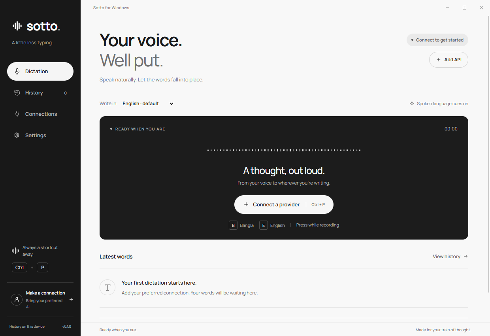
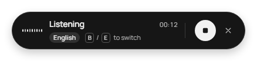
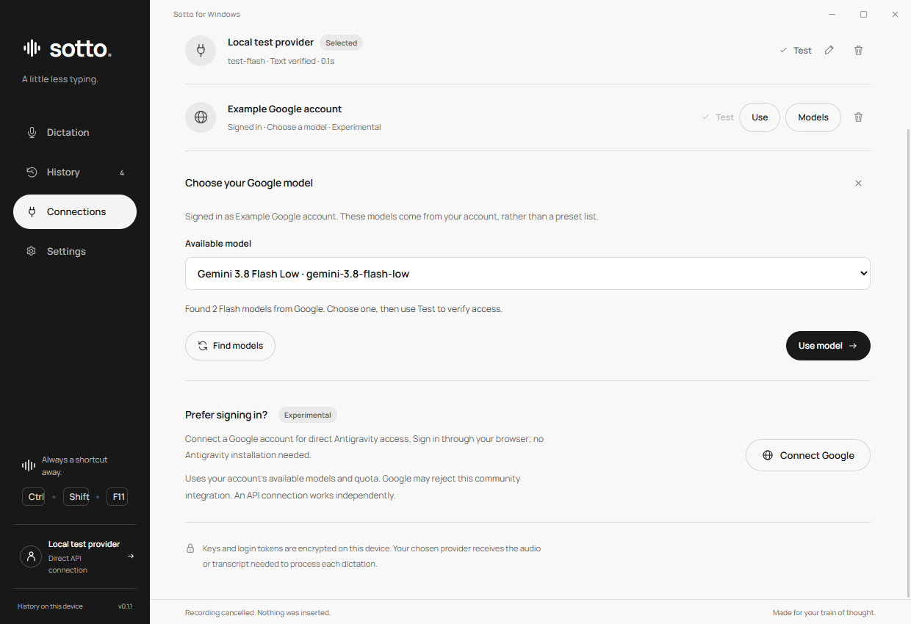

<div align="center">


# Sotto

### Your voice. Well put.

Speak in Bangla, English, or a mix of languages. Turn rough thoughts into polished words, right where you're writing.

**Windows desktop · Portable executable · Bring your own AI · MIT licensed**

[**Download for Windows ↓**](https://github.com/MEmio3/Sotto/releases/download/v0.1.1/Sotto-0.1.1-Windows.exe) · [All releases](https://github.com/MEmio3/Sotto/releases) · [Report an issue](https://github.com/MEmio3/Sotto/issues)



</div>

## A little less typing

Press **Ctrl + P**, say what you mean, then press it again. Sotto records your speech, asks your selected AI to clean it up, and inserts the result into your original textbox. It runs as a desktop app, so it works across ordinary Windows text fields without a browser extension.

The built-in prompt treats your speech as something to edit: it fixes grammar, punctuation and repetition while asking the model to preserve your meaning, names, numbers and tone. Dictated questions stay questions; the model is instructed to return your text rather than answer it.

### What's inside

| Feature | What it does |
| --- | --- |
| **Dictation at your cursor** | A global shortcut starts and stops recording. Sotto checks the original destination before inserting. |
| **Bangla, English, and more** | Use keyboard language shortcuts, select a language, or say which language you want. Support depends on your model. |
| **Floating recorder** | A compact monochrome capsule shows the timer, language, microphone activity and processing state without taking typing focus. |
| **Your choice of AI** | Connect a Gemini API key, a compatible API, or the experimental Google / Antigravity connection. Use **Models** to pick a Flash variant returned by your Google account. |
| **Local history** | Search previous dictations and compare the original transcript with the polished result. Copy, export or rework saved entries. |
| **Writing preferences** | Add your own style instructions, choose conservative or literal cleanup, and polish existing typed text too. |
| **Optional local transcription** | Use an existing whisper.cpp installation for recognition, then send the transcript to your selected AI for editing. |
| **Recovery when things fail** | Keep failed recordings for retry when history is enabled. Results remain ready to copy if insertion cannot proceed. |

<div align="center">

</div>

## Get started

1. Download [**Sotto-0.1.1-Windows.exe**](https://github.com/MEmio3/Sotto/releases/download/v0.1.1/Sotto-0.1.1-Windows.exe) and open it on Windows x64. The portable build needs no Node.js, browser extension, OmniRoute server or Antigravity installation.
2. Open **Connections → Add API**. Choose **Gemini API**, enter your key, discover available models, and save a connection. You can get a key from [Google AI Studio](https://aistudio.google.com/apikey).
3. Select a model and click **Test**. This checks text generation; the first real dictation checks audio support. Discovery prefers Flash-Lite, then Flash, when available. You control the model and provider.
4. Click a textbox in your browser, editor or messaging app. Press **Ctrl + P**, speak, then press **Ctrl + P** again.
5. Your polished words appear at the original cursor. If the destination changed or the model reported unclear speech, open Sotto to review and copy the result.

Closing the window keeps Sotto in the system tray. Choose **Quit** from the tray menu to exit and release its shortcuts.

**Updating from v0.1.0:** quit the old app from the tray before opening the new executable. Your saved connections and history use the same local profile. In **Connections → Models**, load the account's models, choose one and click **Use model**, then **Test**. The new connector repairs invalid project values saved by v0.1.0.

### Shortcuts and language

| Control | Action |
| --- | --- |
| **Ctrl + P** | Start or finish dictation. Change the shortcut in Settings if needed. |
| **B**, while recording | Write the result in Bangla. |
| **E**, while recording | Write the result in English. |
| **Finish / Cancel** in the capsule | Complete the recording or cancel the current operation. |
| **Copy / Dismiss** after completion | Copy your words or hide the capsule. |

Polished English is the default. Spoken language cues are enabled: say something like **“write this in Bangla”** or **“in Spanish, please”**. A clear language request is removed from the finished message; an explicit keyboard or UI selection takes priority. Settings can preserve the spoken language or disable spoken cues and B/E interception.

**Conservative** cleanup removes only unmistakably unrelated asides. **Literal** keeps all substantive content. AI can still misunderstand speech, so review important names, numbers and meaning.

## Choose your connection

### Gemini API

Add your own key and choose a model that supports audio input. Sotto sends the recording with its dictation prompt in one request and asks for the transcript, polished text, output language and any uncertain words.

### Compatible API

Enter your provider's base URL, key, text model and transcription model. Voice mode uses `/audio/transcriptions`, then `/chat/completions` for editing. Providers without audio transcription can use the optional local whisper.cpp path. Remote endpoints require HTTPS; local HTTP endpoints can run without a key if configured.

Sotto does not silently switch models or providers. API usage, pricing, quotas and model availability belong to your chosen provider. No user API keys or account sessions are bundled.

### Google / Antigravity — experimental

In **Connections**, choose **Connect Google** and complete sign-in in your system browser. Sotto uses the OAuth connection directly, checks the account's project and available models, and encrypts the saved session locally. Open **Models**, choose a returned Flash model, and click **Use model** to save your choice and select that connection for dictation. **Find models** refreshes the account's live list. A saved login is separate from verified model access.

<details>
<summary>See the model picker with an example account</summary>



</details>

This community integration references [OmniRoute's MIT-licensed protocol and public installed-client configuration](https://github.com/diegosouzapw/OmniRoute). Sotto handles the connection itself: it does not require a separate OmniRoute setup or read tokens from an installed Antigravity app. v0.1.1 corrects the client protocol headers and project parsing. Live discovery, text editing, and a short synthetic English audio sample were verified with a real Google account, including Gemini 2.5 Flash Lite and Gemini 3.8 Flash Low. That does not guarantee every account, model or language will work.

> [!WARNING]
> **Use the Antigravity connection at your own risk.** It is unofficial and experimental; access may stop working or lead to account restrictions. It does not guarantee free or unlimited usage.

## How it works

```text
Ctrl + P → Record speech → Selected transcription / AI connection
         → Built-in editing prompt + your writing preferences
         → Polished text → Check original destination → Paste or copy
```

Each dictation is an independent request. Local history is an archive, rather than a growing cloud conversation. When insertion is allowed, Sotto uses **Ctrl + V**, never an Enter key, and restores the clipboard if it has not changed in the meantime.

**Recording locally is different from transcribing locally:** by default, Gemini API and Google / Antigravity receive the recorded audio and transcribe it in the cloud. Compatible APIs use the selected transcription endpoint. Only the optional whisper.cpp setting performs recognition on your PC; editing still uses the selected AI connection.

Recordings are limited to **3 minutes**. Some specialized controls and administrator-level apps may block insertion. While Sotto is running, the default Ctrl + P shortcut takes the place of Print; Settings offers alternatives.

## Your data

- **Local archive:** settings, searchable history and retained recordings live under `%APPDATA%\sotto-desktop`.
- **Encrypted credentials:** API keys and Google tokens use Electron safeStorage with Windows account protection. They are excluded from renderer snapshots and history exports.
- **Selected provider only:** cloud processing sends audio or a transcript to the connection you choose. History stays on your device. Sotto includes no analytics.
- **Audio retention controls:** completed recordings are deleted by default. Failed recordings are retained for retry when history is enabled. Deleting a history entry removes its retained audio.
- **History off:** temporary audio is deleted after processing. An in-memory retry remains until the next dictation or exit.

For local recognition, set the paths to your existing `whisper-cli.exe` and multilingual `ggml-*.bin` model in **Settings → Transcription → Local whisper.cpp**. Editing still uses the selected AI connection; this is not a fully offline mode.

## Build from source

Use Windows, Git and Node.js 22.12 or later. All app assets are included.

```powershell
git clone https://github.com/MEmio3/Sotto.git
cd Sotto
npm ci
npm start
```

| Command | Purpose |
| --- | --- |
| `npm start` | Run the Electron app. |
| `npm test` | Run the core and provider tests. |
| `npm run smoke` | Run isolated desktop checks using simulated audio and a local mock provider. |
| `npm run preview` | Serve a UI-only preview at `http://127.0.0.1:4317`. |
| `npm run pack` | Build the unpacked Windows app. |
| `npm run dist` | Create `release/Sotto-0.1.1-Windows.exe`. |

The release build is unsigned. Icons and fonts are already bundled; regenerating assets with `python scripts/assets.py` additionally requires Pillow.

The source is small: `electron/` contains the desktop lifecycle, providers, storage and IPC; `native/` handles Windows focus and insertion; `src/` holds the main interface and floating recorder; `tests/` covers prompts, provider responses, storage and native request handling.

**Verification:** 18 automated tests passed, including Google project parsing, onboarding and request headers. Desktop checks cover model selection, saving and retry after discovery errors. Native Unicode paste, clipboard restoration and focus protection were separately verified. Short real-provider text/audio checks passed; broad recognition accuracy remains unverified. See [verification notes](docs/VERIFICATION.md).

## Coming later

Writing modes for **AI prompts**, **casual messages**, **professional writing** and **custom presets**, each with its own built-in editing prompt. These are planned and are not included in v0.1.1. For now, use **Settings → Your writing preferences** to guide the tone.

## Credits and license

Created by **[MEmio3](https://github.com/MEmio3)** · [maruf.hossain1@g.bracu.ac.bd](mailto:maruf.hossain1@g.bracu.ac.bd)

Released under the [MIT License](LICENSE). Built with Electron and Manrope; the experimental account connection references OmniRoute. See [third-party notices](THIRD_PARTY_NOTICES.md) for attribution. Sotto is an independent project and is not endorsed by Google or OmniRoute.
